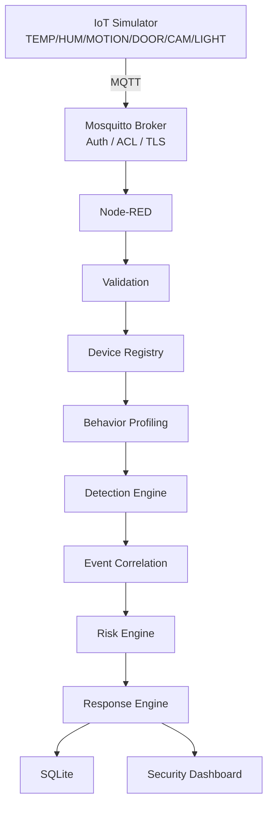

# 04 – Architecture

## System Architecture

## Network

- Dedicated Docker bridge: `iot-sentinel-network`
- Exposed ports (documented):
  - 1883 – MQTT (development / non-TLS)
  - 8883 – MQTT over TLS
  - 1880 – Node-RED UI / Dashboard

## Security Pipeline (logical)

MQTT IN → JSON Decode → Schema Validation → Topic Validation → Device Identity → State Check → Behavior Analysis → Threat Detection → Correlation → Risk Scoring → Response → Database → Dashboard
