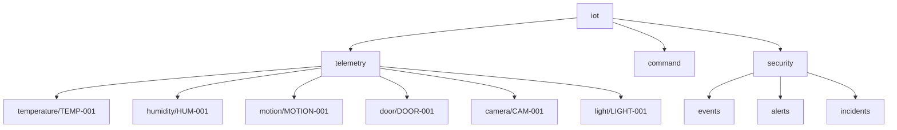

# 06 – MQTT Design

## Topic tree

## Authentication model

| Stage | Port | Anonymous | Password file | Purpose |
|-------|------|-----------|---------------|---------|
| A (default) | 1883 | allowed | optional | Bootstrap and architecture verification |
| B | 1883 + 8883 | denied | required | Final lab security posture |

Authentication answers: **who are you?**

## Authorization (ACL)

File: `broker/config/aclfile`. Each device user may write only its telemetry (and selected command) topics. The `nodered` user may read telemetry and write `iot/security/*`. Default deny closes other paths.

Authorization answers: **what are you allowed to do?**

Application-layer TOPIC_ABUSE detection remains active even when ACL already blocks the publish, providing defense in depth and visibility when Stage A is used.

## TLS

Stage B enables listener 8883 with CA and server certificate generated by `scripts/generate-certs.ps1`. TLS answers: **how is communication protected in transit?**

Handshake (simplified): Client connects to 8883 → TLS handshake with server certificate → MQTT CONNECT with username/password → PUBLISH/SUBSCRIBE under ACL.

Certificate private keys must never be committed.

## Message schema (telemetry)

Required fields: `device_id`, `device_type`, `timestamp`, `sequence`, `value` (and `unit` where applicable). Malformed messages produce SCHEMA_VALIDATION_FAILURE.
